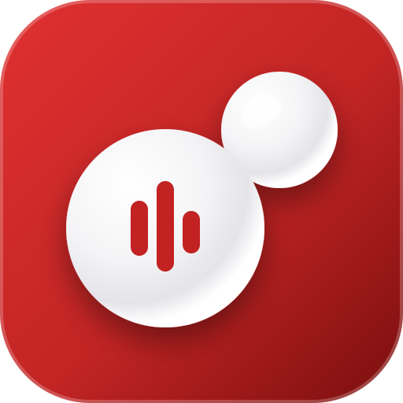

<p align="center">
  
</p>

<h1 align="center">BubbleFM</h1>

<p align="center">
  <strong>A clean, experimental dashboard to explore your monthly Last.fm stats.</strong>
</p>

> [!WARNING]
> **Shutdown Notice (December 1):** BubbleFM will be shut down and archived on **December 1** with its source code preserved. Last.fm announced that holding a Last.fm API key will require a paid [Last.fm Pro subscription](https://support.last.fm/t/api-keys-will-require-pro-from-1st-december/121030). Because this project is 100% free and generates no revenue, keeping the hosted service online is not sustainable.
>
> **Running Locally (BYOK):** Even after the hosted version shuts down, the project remains functional locally on `localhost` (`http://localhost:5173`) under a **BYOK (Bring Your Own Key)** model. **Lyrics** and **Cards** work out of the box without a Last.fm key, while **Charts** and **TasteMatch** work locally using your own Last.fm Pro API key.
>
> **Migration to ListenDeck:** This tool is being migrated for free to [**ListenDeck**](https://github.com/snw-mint/listendeck), which will work powered by **ListenBrainz** instead of Last.fm.

## About

BubbleFM is a web application that allows you to dive deep into your Last.fm listening history. Generate aesthetic charts, view your top artists and tracks, and calculate your total listening minutes for the current week or month.

With the **TasteMatch** feature, you can also compare your music taste directly with friends to see how compatible you are, discovering shared artists and tracks.

## Features

- **Individual Stats:** View your top artists, tracks, and total listening time.
- **TasteMatch:** Compare your scrobbles with another user and generate compatibility reports.
- **Customizable Reports:** Create and export beautiful, shareable reports for social media.
- **Light & Dark Mode:** Seamless theme switching to match your preference.
- **Privacy First:** All data is processed locally in your browser. We use [Umami](https://umami.is/), a privacy-focused and cookie-less analytics tool, to collect anonymous usage data without tracking personal information.

## Live Demo

Experience the live application here: [https://bubblefm.vercel.app/](https://bubblefm.vercel.app/)

## Development

This project is built with Vanilla HTML, CSS, and JavaScript, bundled using Vite.

To run the project locally:

1. Clone the repository.
2. Install dependencies:
   ```bash
   npm install
   ```
3. Start the development server:
   ```bash
   npm run dev
   ```
   The app will run locally at `http://localhost:5173` (`Lyrics` and `Cards` work without Last.fm; `Charts` and `TasteMatch` require a valid Last.fm Pro API key/endpoint).

## License

This project is open-source and licensed under the GNU General Public License v3.0 (GPL-3.0). See the `LICENSE` file for more details.
