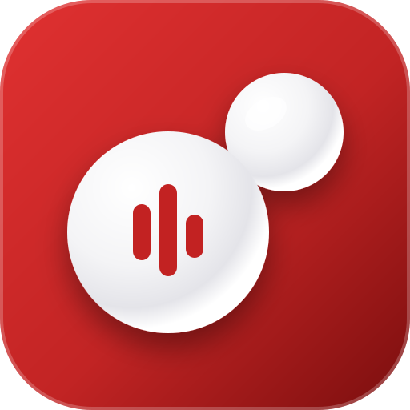

<p align="center">
  
</p>

<h1 align="center">BubbleFM</h1>

<p align="center">
  <a href="https://github.com/snw-mint/bubblefm/activity"></a>
  <a href="https://github.com/snw-mint/bubblefm?tab=GPL-3.0-1-ov-file"></a>
  
</p>

<div align="center">
  
</div>

<p align="center">
  <strong>A clean, experimental dashboard to explore your monthly Last.fm stats.</strong>
</p>

## About

BubbleFM is a web application that allows you to dive deep into your Last.fm listening history. Generate aesthetic charts, view your top artists and tracks, and calculate your total listening minutes for the current week or month.

With the **TasteMatch** feature, you can also compare your music taste directly with friends to see how compatible you are, discovering shared artists and tracks.

## Features

- **Individual Stats:** View your top artists, tracks, and total listening time.
- **TasteMatch:** Compare your scrobbles with another user and generate compatibility reports.
- **Customizable Reports:** Create and export beautiful, shareable reports for social media.
- **Light & Dark Mode:** Seamless theme switching to match your preference.
- **Privacy First:** All data is processed locally in your browser. We use [Umami](https://umami.is/), a privacy-focused and cookie-less analytics tool, to collect anonymous usage data without tracking personal information.

## Live Demo

Experience the live application here: [https://bubblefm.vercel.app/](https://bubblefm.vercel.app/)

## Development

This project is built with Vanilla HTML, CSS, and JavaScript, bundled using Vite.

To run the project locally:

1. Clone the repository.
2. Install dependencies:
   ```bash
   npm install
   ```
3. Start the development server:
   ```bash
   npm run dev
   ```

## License

This project is open-source and licensed under the GNU General Public License v3.0 (GPL-3.0). See the `LICENSE` file for more details.
